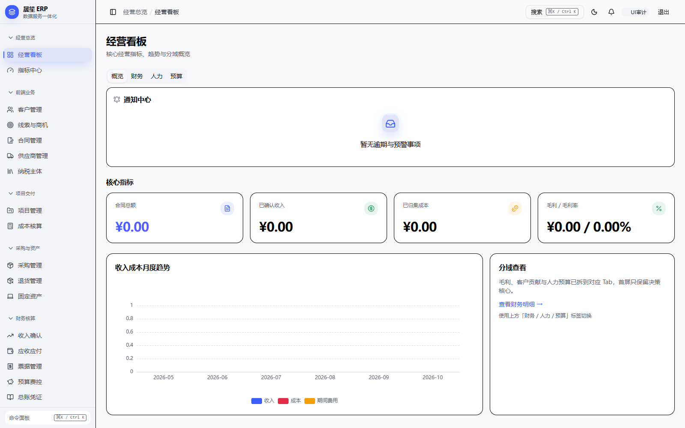
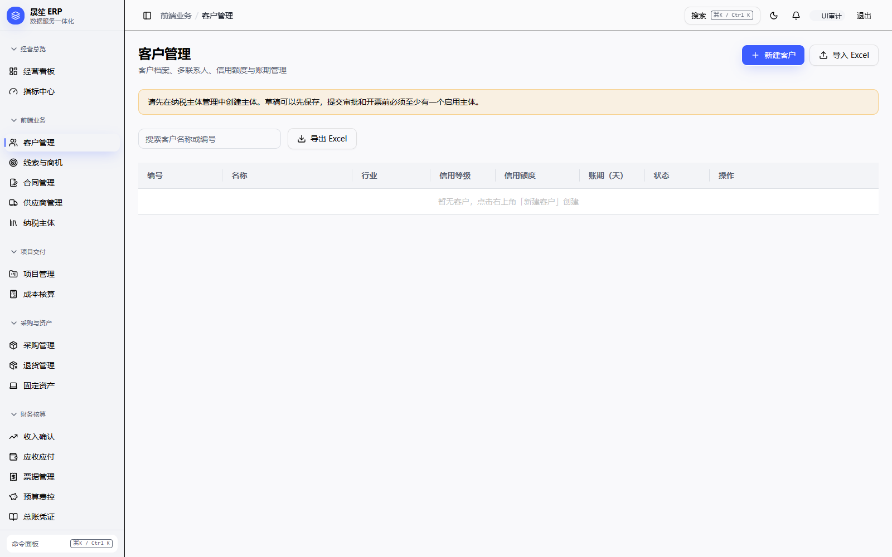
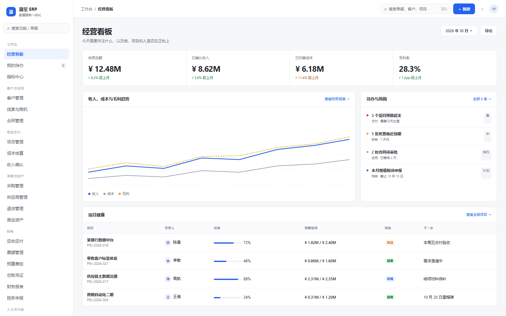
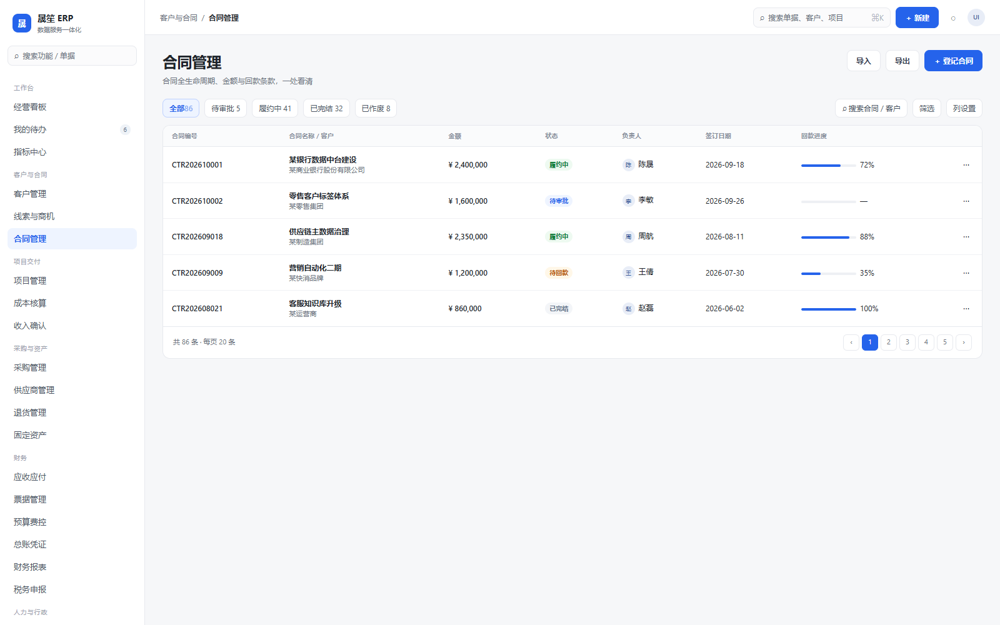
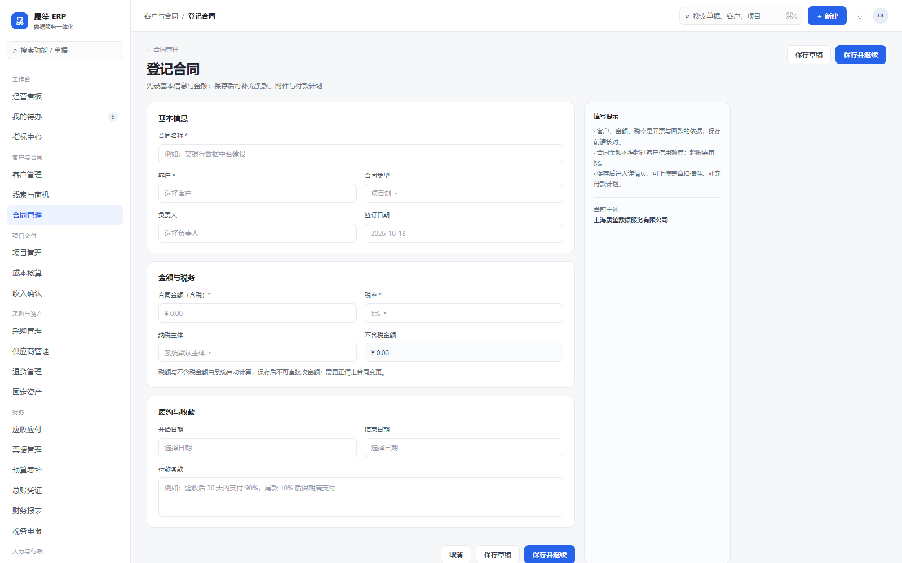

# 晟笙 ERP UI 重设计提案（2026-10-18）

> 本文只做设计审计与重设计提案，**没有修改业务代码**。  
> 审计范围：本机部署 `http://127.0.0.1:3000`，1600×1000，34 个主路由，逐页截图与 DOM 统计。  
> 截图目录：`./screens/`；设计稿：`./mockup/`；原始指标：`./metrics.json`。

---

## 一、先说结论

当前界面不是“不会做 UI”，而是**没有统一的产品骨架**：

1. **导航按模块堆叠，而不是按任务组织**：34 个菜单、9 个分组，财务一组 9 项；「人力资源」既是分组又是菜单；「合规」里放设置， 「前端业务」里放纳税主体/供应商。
2. **页面模板不统一**：同样是列表页，有的操作在页头、有的在筛选区；客户页出现两个「导出 Excel」；财务页是“Tab + 筛选 + 卡片 + 表格”四层。
3. **视觉层级靠边框和卡片堆出来**：指标中心出现卡片套卡片；设置页整屏大白卡只放一个字段；自动化任务是 15 张同构大卡；空白区域占满整屏。
4. **信息密度两极分化**：表格空态时整页空白；指标页又把公式、口径说明全部铺在卡面上，扫读成本高。
5. **重点动作不突出**：页头主按钮、筛选、刷新、导出、Tab 平铺在同一视觉权重；用户不知道“下一步该做什么”。

所以建议不是“换颜色”，而是**重做壳层 + 页面模板 + 信息架构**。业务逻辑和接口保持不动，先做视觉与交互层的替换。

---

## 二、逐页审计（主路由）

### 现状参考





| 页面 | 现状问题 | 重设计方向 |
|---|---|---|
| 经营看板 | 4 个大 KPI + 空通知卡 + 空图表；没有“今天要处理什么” | KPI 横条 + 待办/风险侧栏 + 趋势图 + 项目健康表 |
| 指标中心 | 9 个卡片套内框；公式/口径全部外露；一屏看不完 | 指标列表：名称/值/趋势/口径 icon；详情抽屉看公式 |
| 客户管理 | 页头「导出 Excel」与筛选区「导出 Excel」重复；空表格占满 | 页头只留新建；导出/列设置进表格工具栏；空态 CTA |
| 供应商/合同/项目/成本/收入 | 同一套列表结构，但操作位置、列设置、空态不一致 | 统一 ListPage 模板 |
| 合同登记/项目立项 | 表单居中 560px，字段单列铺开；保存按钮在底部 | 760px 双列分区 + 右侧提示 + 粘性底部操作 |
| 应收应付 | 7 个 Tab + 状态筛选 + 4 个按钮；信息层级多 | Tab 下加摘要条；筛选收进“筛选”抽屉 |
| 财务报表 | 筛选条 + 3 个 Tab + 校验卡 + 大表格；一行 6 个控件 | 期间/主体/口径一行；校验结果折叠；表格为主 |
| 增值税申报 | 页头扫描 + 风险面板 + 筛选 + 6 张指标卡 + 表格；D-06 文案挤在标题 | 风险扫描折叠为右侧提示；指标 3×2；确认底稿粘性按钮 |
| 会计账簿 | 条件多、表宽、横向滚动；筛选占一整行 | 左侧科目树 + 右侧表格；筛选抽屉 |
| 设置 | 整屏大白卡，一个字段占一行；无页内导航 | 左侧设置子导航 + 720px 内容区 |
| 自动化任务 | 15 张卡片，暴露 `admin_rent_expiry_remind` 等技术 ID | 表格：任务/频率/上次执行/状态/开关；ID 进详情 |
| 审计日志 | 7 个筛选控件横排；详情 JSON 直接铺在表格里 | 顶部搜索 + 筛选抽屉；行点击开详情抽屉 |
| 人力资源 | 4+3 张指标卡不齐；图表空 | 4 个 KPI + 2 个图表 + Tab |
| 云空间/知识库 | 配置提示占满整屏，配置前页面无内容 | 三步配置清单 + 配置后空态 |
| 登录/MFA | 登录、MFA 绑定、改密三套表单风格不完全一致 | 统一认证卡片；密钥/二维码/恢复码分步 |

> 说明：首次截图时 4 个页面（采购/资产/凭证/数据资产）遇到部署后 chunk hash 变化；已用新会话重新捕获，现 34 个主路由均有截图。该现象也提示需要补“部署后自动刷新/重试”的交互。

---

## 三、新的信息架构

### 3.1 侧栏：7 个主分组 + 底部工具

| 分组 | 菜单 |
|---|---|
| 工作台 | 经营看板、我的待办（新增）、指标中心 |
| 客户与合同 | 客户管理、线索与商机、合同管理 |
| 项目交付 | 项目管理、成本核算、收入确认 |
| 采购与资产 | 采购管理、供应商管理、退货管理、固定资产 |
| 财务 | 应收应付、票据管理、预算费控、总账凭证、财务报表、会计账簿、税务申报、期末年结 |
| 人力与行政 | 人力资源、行政管理（租房/缴费/资产/车辆差旅作为页内 Tab） |
| 企业文档 | 云空间、知识库 |
| 底部工具 | 系统设置、自动化任务、审计日志、数据资产、纳税主体 |

关键调整：

- 「供应商管理」从“前端业务”移到“采购与资产”；
- 「纳税主体」从业务菜单移到“系统 / 基础数据”；
- 「自动化任务」「审计日志」「数据资产」「设置」合并到“系统”入口，不再占主分组；
- 人力资源/行政管理由“一个菜单+一个分组同名”改为页内 Tab；
- 分组可折叠，默认折叠“企业文档/系统”；支持收藏与搜索；
- 侧栏顶部固定“搜索功能/单据”，底部放“命令面板 ⌘K”。

### 3.2 页面层级

```text
Topbar（56px）：面包屑 / 全局搜索 / 新建 / 通知 / 用户
PageHeader（64px）：标题 + 一句话说明 + 1 个主操作 + 更多操作
Summary（可选，72px）：4 个 KPI 或状态摘要
Toolbar（44px）：搜索 + 筛选 chips + 列设置/导出
Content：表格 / 图表 / 分栏
Drawer：详情、筛选、列设置（不跳页）
```

原则：**一屏只允许一个主按钮**；其余操作进“更多”或工具栏；筛选默认收起，用 chips 展示已选条件。

---

## 四、视觉规范

| 项 | 现值问题 | 建议 |
|---|---|---|
| 背景 | 纯白/浅灰混杂 | `#F6F7F9` 页面底，`#FFFFFF` 内容面 |
| 边框 | 大量 1px 黑/灰边框，卡片套卡片 | 只用 `#E7E9EE` 分隔线；禁止 Card 内再 Card |
| 主色 | 蓝色使用面积过大 | 主色只用于主操作/选中/关键数字；辅助用中性灰 |
| 字体 | 13/14 混用，数字不齐 | 正文 13px，标题 24px，数字 `tabular-nums` |
| 圆角 | 12/16 混杂 | 卡片 12px，控件 8px，标签 10px |
| 阴影 | 到处阴影 | 只有浮层（Dialog/Dropdown/Drawer）有阴影 |
| 密度 | 控件 36/40 混用 | 表单控件 34px，表格行 44px，工具栏 44px |
| 空态 | 整块表格空白 | 120px 高的空态卡：图标 + 一句说明 + 主操作 |
| 反馈 | 大量 toast | 操作结果用页面内 banner；toast 只做轻提示 |

---

## 五、页面模板

### A. 列表页（客户/合同/项目/供应商/采购/资产）

- 页头：`标题 + 说明 + 新建`（只有这一个主按钮）
- 工具栏：搜索框、状态 chips、筛选、列设置、导出
- 表格：首列编号/名称，状态用点+文字，金额右对齐，操作收进 `⋯`
- 行点击开右侧 Drawer，不跳页；Drawer 内“编辑/审批/附件”
- 底部：`共 N 条 · 每页 20` + 页码
- 空态：120px 高，含“新建第一条”按钮

### B. 工作台

- 顶部 4 个 KPI（同一容器分隔，不四张独立卡）
- 主区 2/3 趋势图 + 1/3 “待办与风险”
- 下方项目健康表；只保留 4 列核心信息
- 移除空通知大卡，改为右上角通知入口

### C. 表单页

- 760px 主列 + 260px 右侧提示
- 分区：基本信息 / 金额与税务 / 履约与收款
- 两列字段，金额/税率自动计算只读
- 底部粘性操作条：取消 / 保存草稿 / 保存并继续
- 校验错误就地显示，不用 toast 兜底

### D. 详情页

- 页头：单据号 + 状态 + 金额 + 主操作
- 下方 Tab：概览 / 明细 / 附件 / 审批 / 日志
- 右侧摘要栏：客户、负责人、关键日期
- 关联单据用链接 chip，不铺满表格

---

## 六、关键页面重设计

### 1. 经营看板

- 保留下图结构：KPI 条 → 趋势 + 待办 → 项目健康表
- “待办与风险”按严重度排序，红/黄/蓝点 + 一行说明
- 所有数字加口径 tooltip，不在卡面写公式

### 2. 应收应付

- 顶部 Tab 保留，但 Tab 下加一条摘要：应收余额 / 逾期 / 本月回款 / 待审批
- 操作：`登记应收` 主按钮；`登记回款`、`核销` 放“更多”
- 表格行内显示逾期天数、责任人；点击开 Drawer

### 3. 财务报表/增值税

- 期间/主体/口径收成一行，右侧“刷新/导出”图标
- 校验结果默认折叠为一行“恒等式校验通过”；失败才展开
- 增值税：风险扫描收进右侧折叠面板；6 个指标 3×2；`确认底稿` 固定在页头

### 4. 设置

- 左侧设置导航：外观 / 品牌 / 飞书 / 账号安全 / 字典 / 参数
- 右侧内容最大 720px；每项一行 label + 控件 + 说明
- 保存按钮固定在内容区底部，不跟着长页面滚走

### 5. 自动化任务

- 卡片改表格：任务名 / 频率 / 上次执行 / 结果 / 启用
- 技术 taskKey 只出现在详情 Drawer
- 顶部“全部启用/停用”批量操作

### 6. 审计日志

- 顶部：搜索 + 时间范围 + 模块/操作人（收进筛选）
- 表格：时间/操作人/操作/模块/对象/结果；详情点开 Drawer
- JSON 详情格式化 + 复制，不直接平铺

---

## 七、设计稿

### 经营看板



### 列表页模板（合同管理）



### 表单页模板（登记合同）



静态稿在 `./mockup/*.html`，可直接浏览器打开；当前截图是 1600×1000。

---

## 八、实施顺序（不在本轮动代码）

1. **Phase 0：壳层**（1 周）  
   设计 token、Topbar、Sidebar（分组/折叠/收藏/搜索）、PageHeader、空态组件。
2. **Phase 1：列表页模板**（1 周）  
   客户、供应商、合同、项目、采购、资产；统一工具栏/表格/Drawer。
3. **Phase 2：财务工作台**（1 周）  
   应收应付、财务报表、税务申报、账簿；Tab + 摘要 + 筛选抽屉。
4. **Phase 3：表单/详情/设置**（1 周）  
   合同/项目登记、设置子导航、自动化表格、审计 Drawer。
5. **Phase 4：验收**（2–3 天）  
   1600/1280 截图回归、空态/错误态/加载态、键盘可达性、深浅色（如需要）。

每阶段独立提交，先改壳层与模板，不动接口和业务逻辑；每页保留旧路由与权限码。

---

## 九、需要你确认的 4 个方向

1. **侧栏**：接受“7 个主分组 + 底部系统工具”，还是希望全部平铺？
2. **密度**：偏“紧凑企业后台”（行高 40–44）还是更舒展（行高 48）？
3. **主色**：继续当前蓝色，还是换成更克制的深蓝/墨绿？
4. **范围**：先做“壳层 + 列表页”给你验收，还是一次性做到财务页/表单页？

确认后我再按 Phase 0 开始动代码；在此之前不改业务实现。


